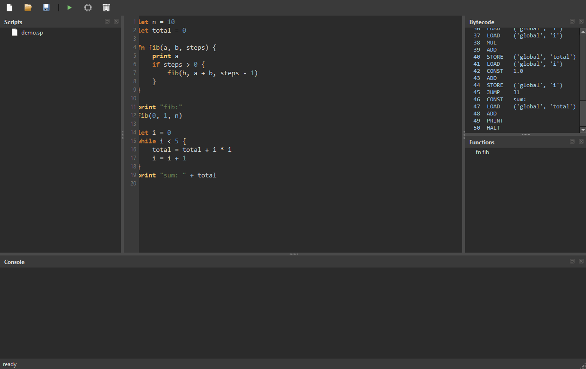

# spark

my own tiny programming language. it compiles to bytecode and runs on a
stack vm i wrote. the ide shows the bytecode live while you type so you
can watch your code turn into machine-ish instructions.

yes i know everybody says "make a language" and nobody does. this one
actually works: variables, functions, recursion, arrays, loops, the lot.

## run it

```
py -3.14 spark.py demo.sp        run a file
py -3.14 spark.py --dis demo.sp  show the bytecode
py -3.14 spark.py                repl
py -3.14 spark.py --ide          the editor (needs PySide6)
```

## what it looks like



the layout is c4d flavored - scripts on the left, editor in the middle,
bytecode + functions on the right, console on the bottom. the bytecode
panel recompiles every time you pause typing.

## the language

```
let n = 10
fn fib(a, b, steps) {
    print a
    if steps > 0 {
        fib(b, a + b, steps - 1)
    }
}
fib(0, 1, n)

let arr = [3, 1, 4]
arr[0] = 99
print "arr: " + arr
```

- `let` for variables, plain `=` to reassign
- `fn name(args) { }` + `return`, recursion works
- `if {} else {}`, `while {}`
- `print` for output
- numbers, strings, true/false, arrays with `[]` indexing
- `--` comments

## how it works inside

`spark.py` is the whole engine in one file (~550 lines):

1. `lex` turns text into tokens
2. `Parser` builds an ast (normal recursive descent, precedence climbing
   for operators)
3. `Compiler` walks the ast and emits ~30 stack ops - CONST/LOAD/STORE,
   arithmetic, jumps, CALL/RET with frames, ARR/IDX/ISTORE
4. `VM` executes: a stack, a globals dict, call frames with locals
   named by slot index

`sparkide.py` is the editor - Qt widgets, QSyntaxHighlighter, a gutter
with line numbers, and a QTimer that recompiles on idle so the bytecode
pane is always fresh.

honest limits: no strings methods, no floats formatting polish, locals
are dict-looked-up not register-indexed, errors are python exceptions
with line info only at parse time. good enough to learn on.
